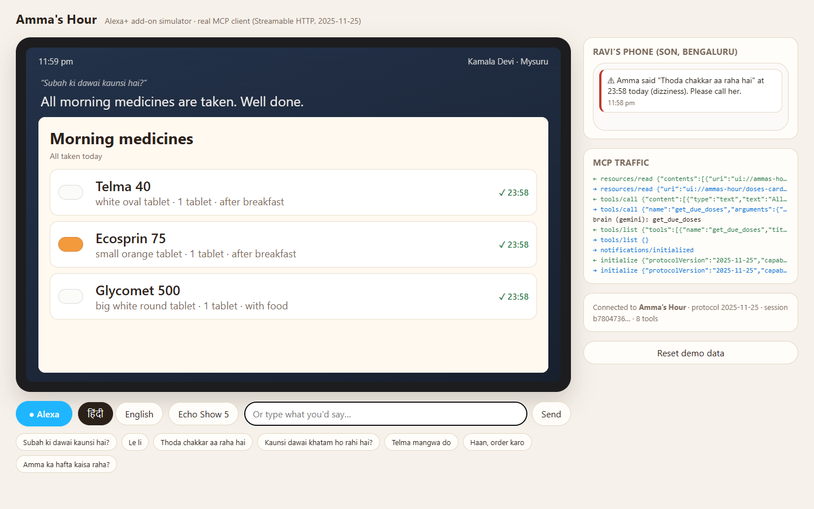

# Amma's Hour

**Live demo (Alexa+ simulator, real MCP server):** https://inquiry-measured-string-reviewing.trycloudflare.com (moved to AWS on 18 Nov 2026 after the Google Cloud billing lapse)

**An Alexa+ add-on for parents who live alone.** Amma's Hour tells an elderly parent which medicines to take, in Hindi or English, catches a double dose before it happens, asks how they feel and alerts the family on warning signs, and refills medicines with a clear "yes". Their son or daughter, living in another city, asks "How is Amma doing this week?" and gets the answer.

Built for the **Alexa+ track** of Amazon's *Build, Ship, Shape* hackathon as a **self-hosted MCP server** implementing **MCP spec 2025-11-25 over Streamable HTTP**, with **MCP Apps** cards for Echo Show and an **Agent Skill**.



## Why

Millions of Indian parents in their 60s and 70s live alone in their home towns while their children work in Bengaluru, Pune or abroad. They take three to six tablets a day, struggle with small print and apps, and their children call every day to ask one question: *"Did you take your tablet?"* Alexa+ launched in India in September 2026 in Hindi, English and Hinglish, so a voice assistant is already in these homes. Voice is the only interface that works for this user: ageing eyes, arthritic fingers, and a moment ("le li", I took it) that happens away from any screen.

## What it does

| The parent says | Amma's Hour (MCP tool) | What happens |
|---|---|---|
| "Subah ki dawai kaunsi hai?" | `get_due_doses` | Reads the morning tablets by name, colour and how to take them; Echo Show gets a pill card. |
| "Le li" / "BP ki dawai le li" | `log_dose` | Logs each dose; brand, generic, colour and Hindi names all resolve. A second dose in the same slot is refused: *"You already took Telma 40 this morning at 8:10. Please don't take it again."* |
| "Thoda chakkar aa raha hai" | `daily_checkin` | Saves the check-in. Warning signs (chest pain, fall, dizziness, breathlessness, fainting, in English, Hinglish or Devanagari) alert the family immediately. Never diagnoses. |
| "Kaunsi dawai khatam ho rahi hai?" | `get_refill_status` | Medicines running out within five days. |
| "Telma mangwa do" | `prepare_refill_order` | Reads the full price breakdown and waits. Refuses a second order of the same medicine on the same day. |
| "Haan, order karo" | `confirm_order` | Places the order only on an explicit yes and sends the receipt to the family. |
| (Family) "How is Amma doing this week?" | `weekly_summary` | Doses taken over 7 days, most-missed medicines, warning signs; Echo Show gets an adherence chart. |
| "What can you do?" | `get_help` | A short spoken summary with example phrases. |

State (doses, check-ins, alerts, orders) persists across sessions, so "did I take last night's tablet?" and the weekly view work days later.

## Architecture

```
 Echo Show simulator (browser, ui/simulator.html)          Claude Desktop / Kiro / any MCP host
   voice in/out (Web Speech, hi-IN / en-IN)                     (same server, same tools)
   real MCP client: initialize → tools/list → tools/call → resources/read
   MCP Apps host: renders ui:// cards in a sandboxed iframe (ui/initialize → tool-result)
        │  Streamable HTTP, Mcp-Session-Id, protocol 2025-11-25
        ▼
 Amma's Hour MCP server (src/server.ts, @modelcontextprotocol/sdk 1.32.1)
   /mcp      8 tools (src/mcp.ts)  +  2 MCP Apps resources (ui/doses-card.html, ui/week-card.html)
   care rules (src/care.ts): IST slots, alias matching, duplicate guard, red flags, refills, weekly view
   state (src/store.ts): JSON file, persists across sessions
   optional bearer token → 401 for Alexa+ account-linking re-auth
 "Alexa brain" (src/brain.ts): Gemini function calling over tools/list, rule-based fallback offline
```

The simulator only *plans* with the brain; every action is a real `tools/call` from the browser to the MCP server, exactly what Alexa+ does with a self-hosted add-on. The official Alexa+ Web Simulator and Local Inspector are partner-only (see [FRICTION_LOG.md](FRICTION_LOG.md)), so the simulator was built to be a faithful client instead.

## Run it

Requires Node.js 24+ (TypeScript runs natively, no build step).

```bash
git clone https://github.com/Ankith-m1006/ammas-hour.git
cd ammas-hour
npm install
npm start            # MCP server on http://localhost:8787/mcp, simulator on http://localhost:8787/
npm test             # 25 tests, mapped to the Alexa+ functional requirements
```

Open http://localhost:8787/ in Chrome or Edge, press **● Alexa** (or type), and try the phrase chips. **Reset demo data** restores the seeded week.

Optional `.env` (see `.env.example`): `GEMINI_API_KEY` lets the simulator understand free-form speech with Gemini function calling (without it, a rule-based router handles the demo phrases); `AMMAS_HOUR_TOKEN` makes `/mcp` require a bearer token and answer **401** otherwise.

### Use it from Claude Desktop (or any MCP host)

```json
{
  "mcpServers": {
    "ammas-hour": { "command": "npx", "args": ["mcp-remote", "http://localhost:8787/mcp"] }
  }
}
```

The Agent Skill in [skills/ammas-hour-care/SKILL.md](skills/ammas-hour-care/SKILL.md) teaches any agent the care routine: when to call which tool, the double-dose and explicit-yes rules, and what never to say.

## Built against Amazon's Alexa+ functional requirements

`test/requirements.test.ts` talks to the server through a real MCP client and names the requirement each test checks ([functional requirements](https://developer.amazon.com/docs/alexaplus/add-ons/functional-requirements.html)):

| Requirement | How |
|---|---|
| 13.1 every tool invocable · 13.2 valid inputSchema with required params · 13.3/13.8 invalid params rejected | zod schemas; out-of-range input returns `isError` and nothing is ordered |
| 13.5 MCP error contract · 2.3/2.5 actionable errors | `isError: true` with a spoken next step |
| 13.6 stable ids across steps | `orderId` from `prepare_refill_order` accepted by `confirm_order` |
| 13.7/13.10 distinct descriptions, synonyms in parameters | brand, generic, colour and Hindi names in the `medicine` description |
| 2.2/9.5 no JSON, ids, tool names or screen references in speech | checked on every tool's spoken text |
| 1.2 context across sessions · 1.4 start over | persisted state; "start over" clears client context |
| 4.2 "what can you do" | `get_help` |
| 8.1/8.19 confirmation with details and a written receipt · 8.10 duplicates · 8.12/8.16/9.3 explicit yes after the full price | refill flow |
| 9.2 at most five options | disambiguation capped at five |
| 6.4 401 on an invalid token | `AMMAS_HOUR_TOKEN` |
| 10.1 card and voice agree · 11 cards render | MCP Apps cards built from the same structured result |
| 2.6 interim message when slow | simulator says "One moment" after 1.5 s |

## Safety and privacy

- Adherence and family connection only: no diagnosis, no dosing advice, no dose changes. Warning signs always point to family and to 112.
- Orders need an explicit yes to a read-out price; anything unclear cancels.
- The repo contains only synthetic data (Kamala Devi and Ravi are fictional). Refill orders and family messages are simulated in this build; in production they would go to a pharmacy partner and SMS/email.

## Project layout

```
src/server.ts      Streamable HTTP server (/mcp), simulator, demo endpoints
src/mcp.ts         MCP tools and MCP Apps resources
src/care.ts        care rules (pure, tested)
src/store.ts       state + seeded demo week
src/brain.ts       simulator brain (Gemini function calling, rule fallback)
ui/                simulator + MCP Apps cards
skills/            Agent Skill (SKILL.md)
test/              requirement-mapped tests
FRICTION_LOG.md    what got in the way while building
```

## License

MIT
